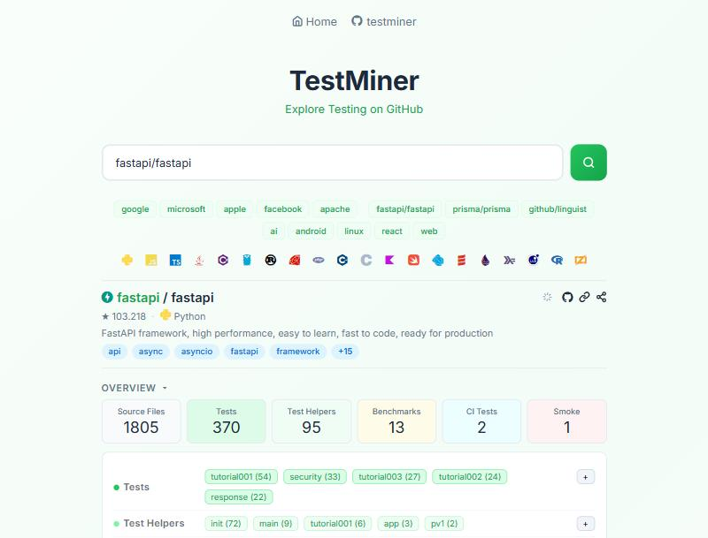
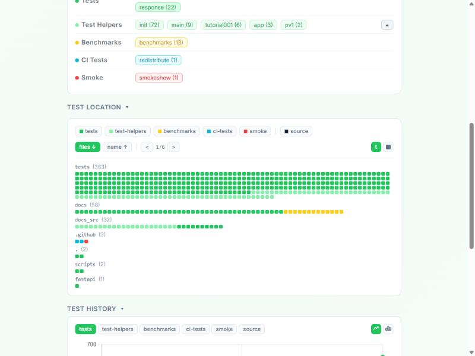
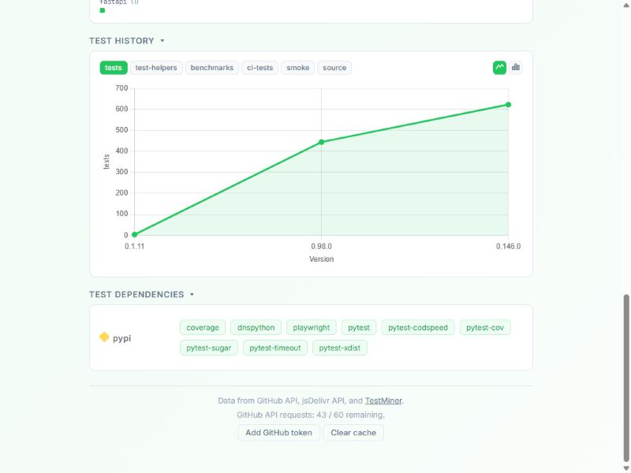
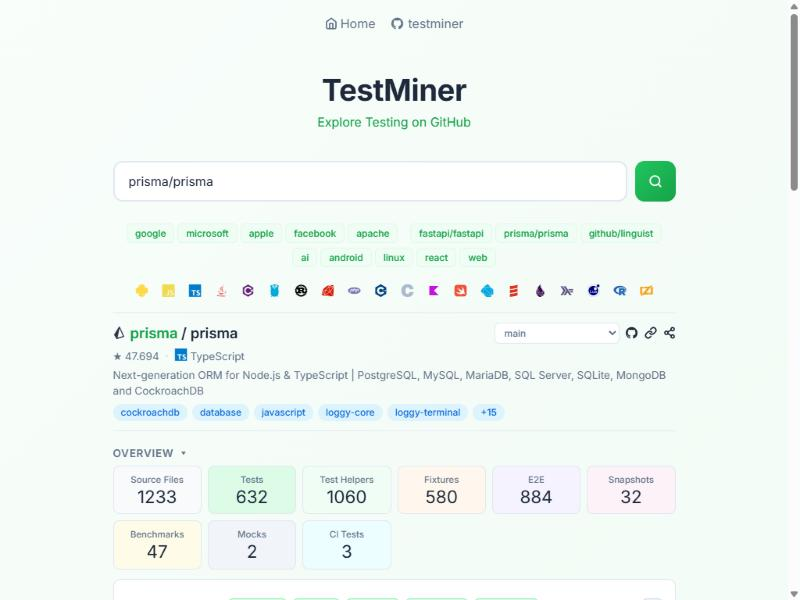
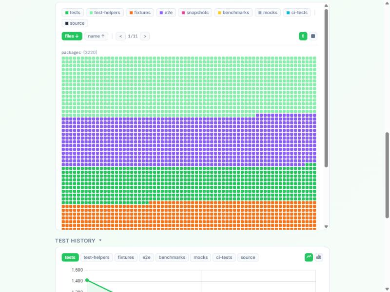
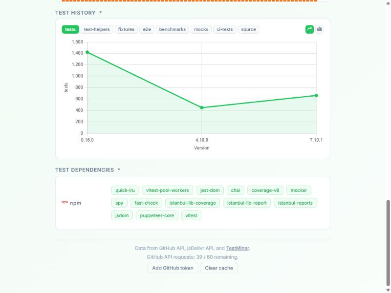

# Explorando Práticas de Teste

Neste exercício, vamos explorar práticas de teste em sistemas reais utilizando a ferramenta [TestMiner](https://andrehora.github.io/testminer).

O TestMiner permite visualizar e analisar testes de software em repositórios do GitHub, fornecendo dados sobre como os projetos organizam seus testes, como eles evoluem entre versões e quais bibliotecas de teste são utilizadas.
Explore a ferramenta antes de começar para se familiarizar com seu funcionamento.

Mais detalhes no GitHub da ferramenta: https://github.com/andrehora/testminer.

---

## Passo 1: Selecionar DOIS repositórios

Escolha dois repositórios reais que possuam testes de software.
Abaixo estão alguns links para ajudá-lo a encontrar projetos interessantes:

- Python: https://github.com/topics/python?l=python
- JavaScript: https://github.com/topics/javascript?l=javascript
- TypeScript: https://github.com/topics/typescript?l=typescript
- Java: https://github.com/topics/java?l=java

- Tópicos: [ai](https://andrehora.github.io/testminer/#topic:ai), [llm](https://andrehora.github.io/testminer/#topic:llm), [api](https://andrehora.github.io/testminer/#topic:api), [nodejs](https://andrehora.github.io/testminer/#topic:nodejs), [android](https://andrehora.github.io/testminer/#topic:android)

- Por organização: [Google](https://andrehora.github.io/testminer/#google), [Microsoft](https://andrehora.github.io/testminer/#microsoft), [Apple](https://andrehora.github.io/testminer/#apple), [Facebook](https://andrehora.github.io/testminer/#facebook), [Netflix](https://andrehora.github.io/testminer/#netflix), 
[GitHub](https://andrehora.github.io/testminer/#github), [Apache](https://andrehora.github.io/testminer/#apache), [HuggingFace](https://andrehora.github.io/testminer/#huggingface)

## Passo 2: Explorar os repositórios selecionados

Busque os repositórios escolhidos no [TestMiner](https://andrehora.github.io/testminer) e analise os dados de teste gerados pela ferramenta.

## Passo 3: Explicar as prática de teste

Para cada repositório, escolha uma prática ou dado de teste relevante e explique com suas próprias palavras.

---

## Instruções de entrega

1. Faça um `fork` deste repositório (saiba mais sobre forks [aqui](https://docs.github.com/pt/pull-requests/collaborating-with-pull-requests/working-with-forks/fork-a-repo)).
2. Responda às questões abaixo diretamente neste arquivo `README.md` do seu fork. Pode adicionar imagens para enriquecer sua explicação.
3. No Moodle, submeta apenas a URL do seu fork.

---

## Respostas

### Repositório 1 

Repositório: `https://github.com/fastapi/fastapi`

URL TestMiner: `https://andrehora.github.io/testminer/#fastapi/fastapi`

Explicação:

O FastAPI é um framework web em Python com 1805 arquivos-fonte e 370 testes catalogados pelo TestMiner, organizados em Tests, Test Helpers, Benchmarks, CI Tests e Smoke.

O ponto mais interessante é cruzar duas seções da ferramenta: "Test Location" e "Test Dependencies".

Na seção **Test Location**, dá para ver que, além da pasta `tests` (383 arquivos), a pasta `docs_src` (32 arquivos) também é tratada como teste (barras verdes, mesma cor de `tests`). Essa pasta guarda os exemplos de código que aparecem na documentação oficial do FastAPI. Ou seja, o projeto não apenas documenta exemplos de uso: ele *executa* esses exemplos como parte da suíte de testes, garantindo que a documentação nunca fique desatualizada ou com código que não funciona mais. Essa prática é chamada de "documentação testável" (ou *doc testing*).

Na seção **Test Dependencies**, aparecem os pacotes PyPI usados para testar: `pytest`, `pytest-cov`, `pytest-xdist`, `pytest-timeout`, `pytest-sugar`, `pytest-codspeed`, `playwright`, `coverage` e `dnspython`. Três deles mostram práticas específicas:
- `pytest-xdist` distribui a execução dos 370 testes entre múltiplos processos/núcleos, paralelizando a suíte para reduzir o tempo de CI.
- `playwright` permite testes de ponta a ponta (E2E) que abrem um navegador real, usados provavelmente para validar a documentação interativa (Swagger UI) gerada automaticamente pelo framework.
- `pytest-codspeed` transforma benchmarks de performance em testes contínuos (há 13 arquivos na categoria "Benchmarks"), permitindo detectar regressões de performance a cada mudança no código, não só bugs funcionais.

Em resumo: o FastAPI combina testes unitários, testes de documentação executável, testes E2E de navegador e benchmarks de performance no mesmo pipeline, em vez de tratar cada tipo de verificação separadamente.

### Repositório 2

Repositório: `https://github.com/prisma/prisma`

URL TestMiner: `https://andrehora.github.io/testminer/#prisma/prisma`

Explicação:

O Prisma é um ORM em TypeScript organizado como monorepo (pacote `packages`, com 3220 arquivos). O TestMiner mostra 1233 arquivos-fonte e uma suíte de testes dividida em sete categorias bem distintas: Tests (632), Test Helpers (1060), Fixtures (580), E2E (884), Snapshots (32), Benchmarks (47), Mocks (2) e CI Tests (3).

O mapa de arquivos da pasta `packages` (visualização "Test Location") deixa visível a escala e a mistura de categorias de teste dentro de um único monorepo: blocos verdes (tests/test-helpers), roxos (e2e) e laranjas (fixtures) convivem lado a lado em milhares de arquivos, o que mostra que cada pacote do Prisma mantém sua própria suíte local, em vez de centralizar tudo em uma única pasta de testes.

Duas práticas de teste se destacam ao olhar "Test Dependencies":
- **Snapshot testing**: a categoria "Snapshots" (32 arquivos) indica que, para saídas complexas e difíceis de comparar manualmente (como o schema de um banco de dados introspectado pelo Prisma), o teste salva a saída gerada uma vez e, nas execuções seguintes, compara automaticamente com esse snapshot salvo. Isso evita escrever asserções enormes à mão e torna fácil perceber quando uma mudança no código altera uma saída que não deveria mudar.
- **Property-based testing**: a dependência `fast-check` (visível junto com `vitest`, `jest-dom`, `chai`, `jsdom` e `puppeteer-core`) indica que parte dos testes não usa exemplos fixos de entrada. Em vez disso, a biblioteca gera automaticamente centenas de entradas aleatórias (dentro de regras definidas) para validar invariantes do código, aumentando a chance de encontrar casos extremos que testes escritos manualmente dificilmente cobririam.

Vale notar também, no gráfico "Test History", que o número de testes caiu bruscamente de ~1400 (versão 0.16.0) para ~450 (versão 4.10.0) antes de voltar a crescer até ~650 (versão 7.10.1) — um indício de que o projeto passou por uma reorganização ou consolidação grande da suíte de testes ao longo de sua evolução, e não apenas crescimento constante.
